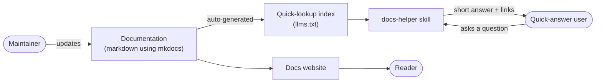

# docs-helper

A MkDocs site, an auto-generated `llms.txt` index, and a AI skill that answers questions from the docs with links to the source sections.

## Background: the two building blocks

**MkDocs** is a static site generator for documentation. You write plain markdown files in a `docs/` folder, list them in a `mkdocs.yml` config, and MkDocs turns them into a searchable, navigable website (here with the Material theme). It's built for humans: people browse the navigation, read pages and use the search box. `uv run mkdocs serve` previews it locally.

**`llms.txt`** is the same idea for AI. It's a plain-text, markdown-formatted file at a site's root (`/llms.txt`) that gives an LLM a compact map of the site: a title, a short summary and a list of links to the important pages. It is the AI-friendly counterpart to `sitemap.xml`. Instead of making a model read every page or parse HTML, it can read this one small file, decide which links matter, and fetch only those. It's a community convention (proposed at [llmstxt.org](https://llmstxt.org)), not an enforced standard.

| | Audience | Format | Used for |
| --- | --- | --- | --- |
| MkDocs site | People | Rendered HTML pages | Browsing and reading |
| `llms.txt` | LLMs and agents | One markdown index | Finding the right page fast |

This project builds both from the same markdown files, so they never drift apart.

## 1. Business problem

Documentation has to serve two kinds of readers:

- **Readers** who like to browse and read the docs in full, following links and getting the whole picture.
- **Quick-answer users** who have a specific question and want the answer now, without hunting through pages.

A docs site alone serves the first group well and the second poorly. Docs that are missing or out of date also go unnoticed.

`docs-helper` serves both from one source of truth. The MkDocs site is for readers. For quick answers, a Claude skill takes a plain-language question and returns a short answer with links to the exact sections, so those users can read further if they want. If the docs don't cover the question, it says so and points to where the docs should be updated. That turns unanswered questions into a visible list of documentation gaps instead of confident answers from general knowledge.

### A growing knowledge base

A maintainer only has to keep the markdown docs up to date. Each change flows into the website and the `llms.txt` index automatically, so nothing else needs maintaining. As new users join and ask the same questions, the skill answers them straight from the latest docs, so the maintainer doesn't have to repeat the same answers. When a question isn't covered, the maintainer adds a section and the next person gets the answer.

## 2. The data

The data is a set of markdown files in [`docs/`](docs/): generic testing guides (overview, unit, integration, test data) and a FAQ (general, troubleshooting). Each page has one h1, several h2 sections and some h3 subsections.

Reading every page for every question is slow and wasteful, so the pages are summarised into an index first. The same markdown files feed both audiences:



Each line in `llms.txt` links to a heading, with h3 entries indented under their h2:

```
- [Mocking dependencies](docs/testing/unit-testing.md#mocking-dependencies)
  - [Mocking a database](docs/testing/unit-testing.md#mocking-a-database)
```

## 3. Results

The skill lives at [`.claude/skills/docs-helper/SKILL.md`](.claude/skills/docs-helper/SKILL.md). Run Claude Code from this folder and invoke it:

```
/docs-helper how do I mock a database in tests?
```

It refreshes the index, picks the best-matching headings, reads only those sections, and replies with a summary plus a Sources list of links.

| Query | Expected behaviour |
|---|---|
| `how do I mock a database in tests?` | Answers from "Mocking dependencies", links `docs/testing/unit-testing.md#mocking-dependencies` |
| `my tests are slow` | Answers from "Tests are slow", links `docs/faq/troubleshooting.md#tests-are-slow` |
| `how do I deploy to Kubernetes?` | Says the docs don't cover it, suggests adding a page under `docs/`, does not answer from general knowledge |

<!-- TODO: replace the table above with real outputs/screenshots from testing -->

## 4. Limitations

- The index only holds h1-h3 headings; h4 and deeper are not indexed. If a section's useful content isn't reflected in its heading, the skill can miss it.
- Matching is done by the model reading `llms.txt`, not by a search engine. That works for small docs but won't scale to hundreds of pages without a bigger index.
- Anchors are generated to match MkDocs' default slugs. Custom heading ids or duplicate headings on one page can produce wrong links.
- Links are local markdown paths, not published site URLs.
- The sample docs are generic. Quality of answers depends entirely on the quality of the docs.

## Quick start

### Prerequisites

- **uv**: manages Python and the project's dependencies, so a separate Python install isn't needed.
- **Claude Code**: to use the `/docs-helper` skill.
- **Git**: to clone the repository.

Install commands by operating system (check the official guides for the latest: [uv](https://docs.astral.sh/uv/getting-started/installation/), [Claude Code](https://docs.claude.com/en/docs/claude-code/setup), [Git](https://git-scm.com/downloads)):

| Tool | macOS | Linux | Windows (PowerShell) |
| --- | --- | --- | --- |
| uv | `brew install uv` or `curl -LsSf https://astral.sh/uv/install.sh \| sh` | `curl -LsSf https://astral.sh/uv/install.sh \| sh` | `powershell -ExecutionPolicy ByPass -c "irm https://astral.sh/uv/install.ps1 \| iex"` or `winget install --id=astral-sh.uv -e` |
| Claude Code | `curl -fsSL https://claude.ai/install.sh \| bash` or `brew install --cask claude-code` | `curl -fsSL https://claude.ai/install.sh \| bash` | `irm https://claude.ai/install.ps1 \| iex` or `winget install Anthropic.ClaudeCode` |
| Git | `brew install git` | `sudo apt install git` (Debian/Ubuntu) or `sudo dnf install git` (Fedora) | `winget install --id Git.Git -e` |

Confirm with `uv --version`, `claude --version` and `git --version`.

### Run it

```bash
git clone https://github.com/manickpillai/ai-in-practice.git
cd ai-in-practice/docs-helper
uv sync
uv run mkdocs serve        # http://127.0.0.1:8000, llms.txt at /llms.txt
claude                     # then: /docs-helper <your question>
```
