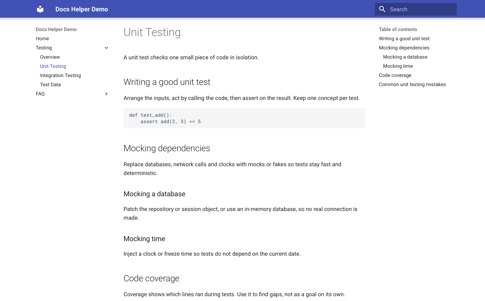
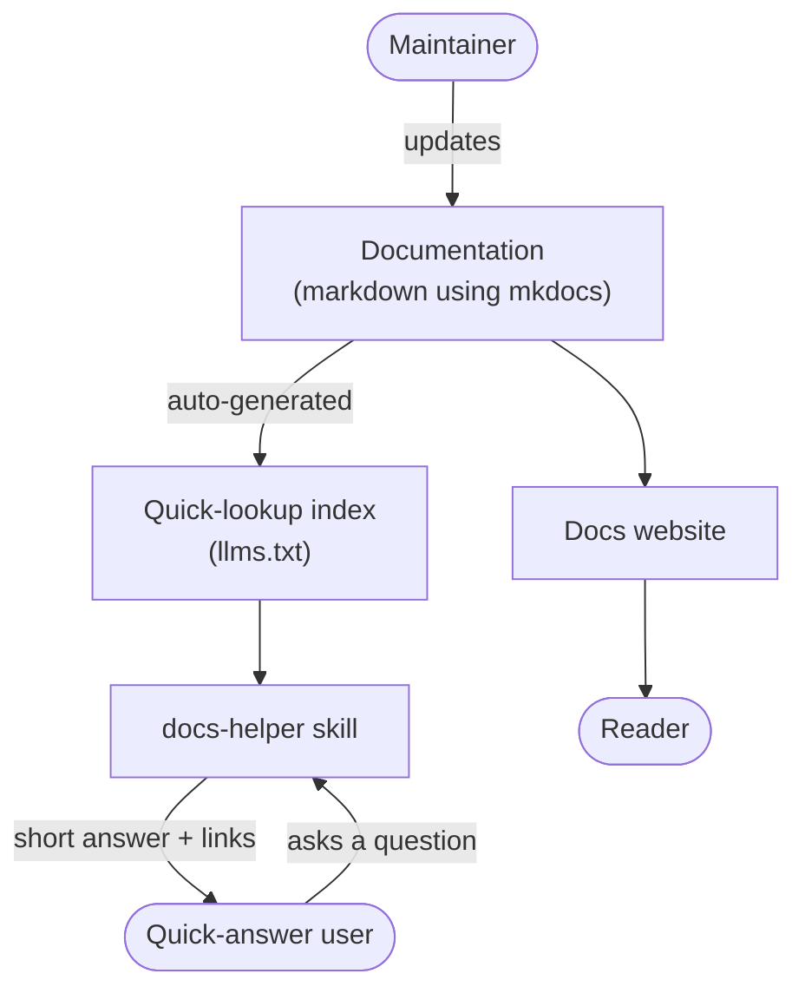
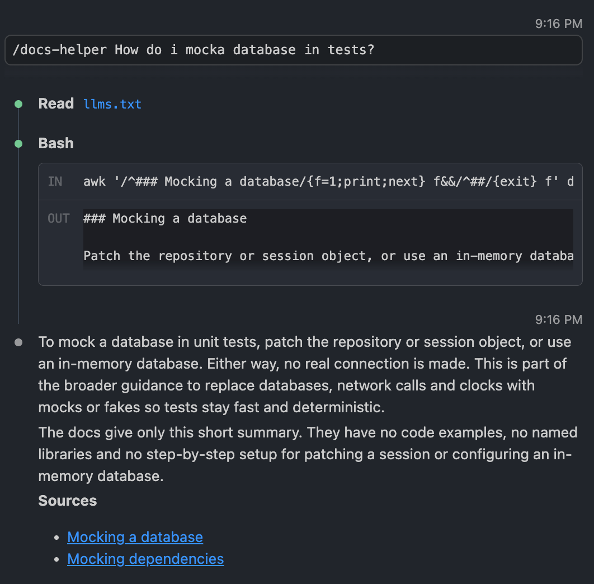
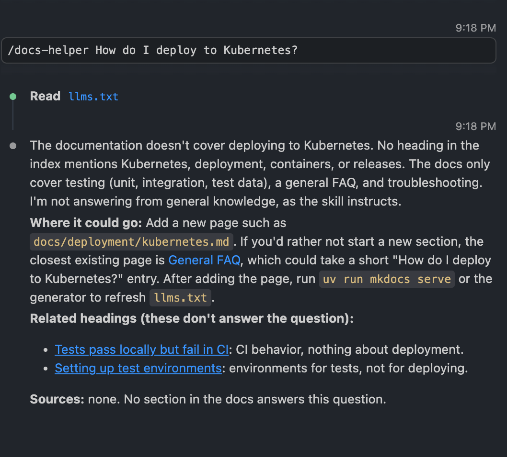

# docs-helper

A MkDocs site, an auto-generated `llms.txt` index and an AI [skill](.claude/skills/docs-helper/SKILL.md) that answers questions from the docs with links to the source sections.

## Business problem

Docs serve people who browse well, but people with a quick question poorly. Gaps and stale pages also go unnoticed.

- **Readers** browse the MkDocs site.
- **Quick-answer users** ask the skill and get a short answer with links to the exact sections.
- **Maintainers** see documentation gaps. If the docs don't cover a question, the skill says so instead of guessing. Add the section and the next person gets the answer.

## Quick start

Install the [prerequisites](readme/quick-start.md#prerequisites) (uv, Claude Code, Git), then:

1. Clone the repo:

   ```bash
   git clone https://github.com/manickpillai/ai-in-practice.git && cd ai-in-practice/docs-helper
   ```

2. Start Claude Code, then ask with `/docs-helper <your question>`:

   ```bash
   claude
   ```

To browse the MkDocs site locally:

1. Run:

   ```bash
   uv sync && uv run mkdocs serve
   ```

2. Open <http://127.0.0.1:8000>.

## Background

**[MkDocs](https://www.mkdocs.org/)** is a static site generator for documentation. You write markdown files in a `docs/` folder, list them in `mkdocs.yml`, and it builds a searchable, navigable website (here with the Material theme). It's built for people to browse.

**[`llms.txt`](https://llmstxt.org)** is the same idea for AI: a markdown file at a site's root (`/llms.txt`) with a title, a short summary and links to the important pages. It is the AI counterpart to `sitemap.xml`. A model reads this one small file, decides which links matter, and fetches only those. It's a community convention, not a standard.

| | Audience | Format | Used for |
| --- | --- | --- | --- |
| MkDocs site | People | Rendered HTML pages | Browsing and reading |
| `llms.txt` | LLMs and agents | One markdown index | Finding the right page fast |



## How it works

Both are built from the same markdown files, so they never drift apart. More in [how it works](readme/how-it-works.md).



## See it in action

**Question the docs cover.** The skill answers from the matching section, links the sources and notes that the docs are thin on detail:



**Question the docs don't cover.** The skill declines to answer from general knowledge, suggests where to add the missing page and lists related headings that don't answer it:



More queries and Copilot setup: [using the skill](readme/usage.md).

## More

[Quick start](readme/quick-start.md) · [How it works](readme/how-it-works.md) · [Using the skill](readme/usage.md) · [Limitations](readme/limitations.md)

---

Built by [Manick](https://github.com/manickpillai) · More projects in [ai-in-practice](../README.md)
