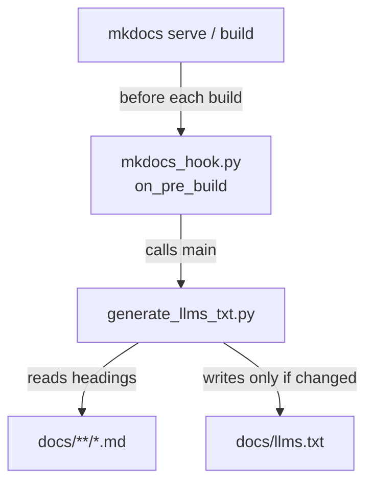

# How it works

[← Back to README](../README.md)

The data is a set of markdown files in [`docs/`](../docs/): generic testing guides (overview, unit, integration, test data) and a FAQ (general, troubleshooting). Each page has one h1, several h2 sections and some h3 subsections.

Reading every page for every question is slow and wasteful, so the pages are summarised into an index first (see the diagram in the [README](../README.md#how-it-works)).

Each line in `llms.txt` links to a heading, with h3 entries indented under their h2:

```text
- [Mocking dependencies](docs/testing/unit-testing.md#mocking-dependencies)
  - [Mocking a database](docs/testing/unit-testing.md#mocking-a-database)
```

## Keeping the index up to date

Two small scripts in [`scripts/`](../scripts/) build the index, so nobody edits `llms.txt` by hand.



### The hook

[`mkdocs_hook.py`](../scripts/mkdocs_hook.py) is a [MkDocs hook](https://www.mkdocs.org/user-guide/configuration/#hooks), registered in `mkdocs.yml`:

```yaml
hooks:
  - scripts/mkdocs_hook.py
```

MkDocs calls its `on_pre_build` function before every build. That includes each live-reload rebuild under `mkdocs serve`, so saving a doc refreshes the index. The hook only calls `generate_llms_txt.main()`.

### The generator

[`generate_llms_txt.py`](../scripts/generate_llms_txt.py) uses only the Python standard library. For each markdown file under `docs/`, in sorted order, it:

1. Collects the h1, h2 and h3 headings, skipping anything inside a code fence so `#` comments in code blocks are not mistaken for headings.
2. Turns each heading into an anchor with `slugify`, which approximates the ids MkDocs generates (lowercase, punctuation dropped, spaces to hyphens). The h1 gets no anchor, since it links to the page itself.
3. Writes one line per heading, indenting h3 entries under their h2, under a `## Page title (path)` group for the page.
4. Writes `docs/llms.txt` only if the content changed. Without this check the write would trigger MkDocs' file watcher, which would rebuild, call the hook again and loop.

Pages with no headings are skipped. To regenerate without starting the site:

```bash
uv run python scripts/generate_llms_txt.py
```
